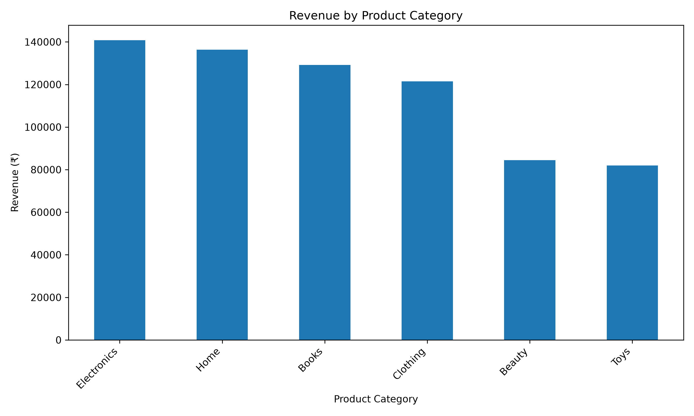
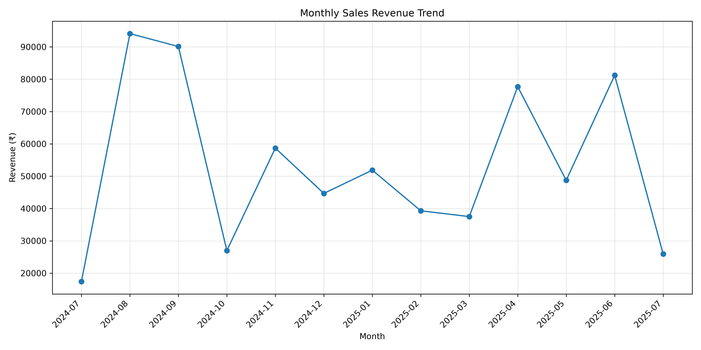
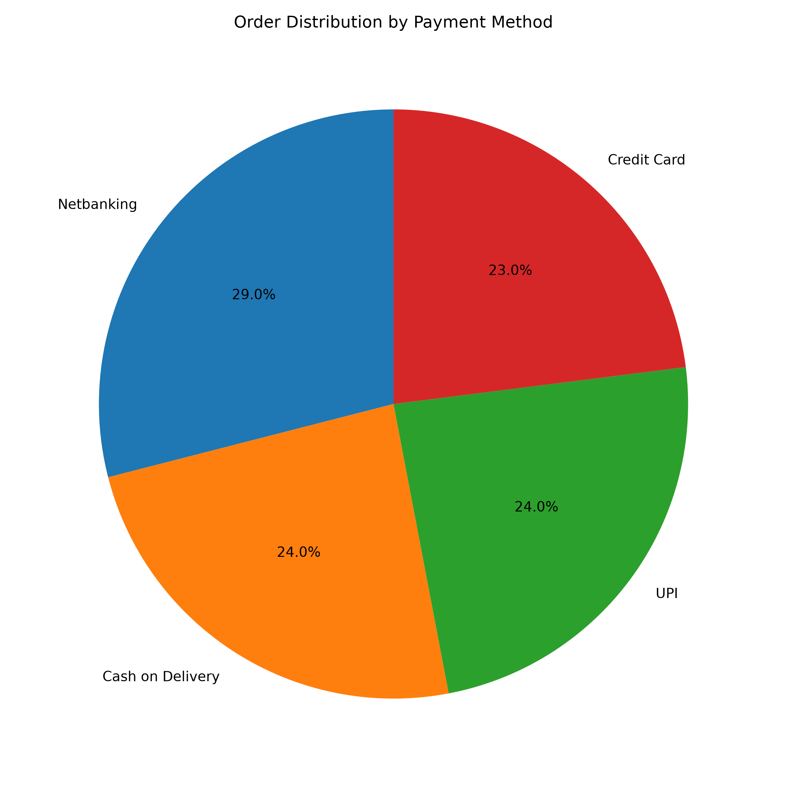
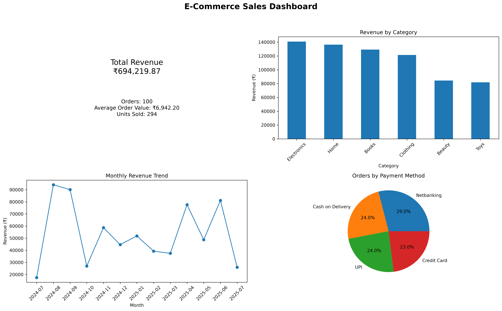

# E-Commerce Sales Analysis — Week 1

A beginner-friendly Data Science project focused on data cleaning, exploratory data analysis (EDA), business insights, and visualization using Python.

## Project Overview

This project analyzes an e-commerce sales dataset to understand revenue performance, product sales, customer behavior, and payment preferences. It was completed as part of the Week 1 Data Science internship assignment at Welnt ern Pvt. Ltd.

## Objectives

- Clean and validate raw sales data.
- Perform exploratory data analysis using Pandas and NumPy.
- Calculate key business metrics.
- Identify top-performing products, categories, and sales periods.
- Visualize findings using Matplotlib and Seaborn.

## Tools and Technologies

- Python
- Pandas and NumPy
- Matplotlib and Seaborn
- Jupyter Notebook
- Git and GitHub

## Key Business Insights

| Metric | Result |
|---|---:|
| Total Revenue | ₹694,219.87 |
| Total Orders | 100 |
| Average Order Value | ₹6,942.20 |
| Units Sold | 294 |
| Highest-Revenue Category | Electronics |
| Highest-Revenue Month | August 2024 |
| City with Most Orders | Chennai |
| Unique Customers | 98 |

### Additional Findings

- Electronics generated ₹140,811.26 in revenue.
- Curtains was the highest-revenue product, generating ₹79,023.10.
- August 2024 recorded the highest monthly revenue of ₹94,121.76.
- Chennai recorded the highest number of orders, with 22 orders.

## Data Visualizations

### Revenue by Category



### Monthly Sales Trend



### Payment Method Distribution



## Dashboard Preview



## Project Structure

```text
data-science-week1-assignment/
├── data/
│   ├── raw/
│   │   └── ecommerce_sales_data.csv
│   └── cleaned/
│       └── cleaned_dataset.csv
├── notebooks/
│   └── week1-analysis.ipynb
├── outputs/
│   ├── charts/
│   └── dashboard/
├── reports/
│   └── final_report.md
├── .gitignore
├── README.md
└── requirements.txt
```

## How to Run the Project

### 1. Clone the repository

```bash
git clone https://github.com/SankalpP2620/data-science-week1-assignment.git
cd data-science-week1-assignment
```

### 2. Create and activate a virtual environment

On macOS or Linux:

```bash
python3 -m venv .venv
source .venv/bin/activate
```

### 3. Install dependencies

```bash
pip install -r requirements.txt
```

### 4. Launch Jupyter Notebook

```bash
jupyter notebook
```

Open `notebooks/week1-analysis.ipynb` and run the cells in order.

## Project Deliverables

- Raw and cleaned datasets
- Jupyter Notebook containing the analysis
- Sales visualization charts
- Dashboard mockup
- Final project report

## Author

**Sankalp Padhi**

GitHub: [SankalpP2620](https://github.com/SankalpP2620)

---

*This project demonstrates foundational skills in Python, data cleaning, exploratory data analysis, visualization, and version control.*
